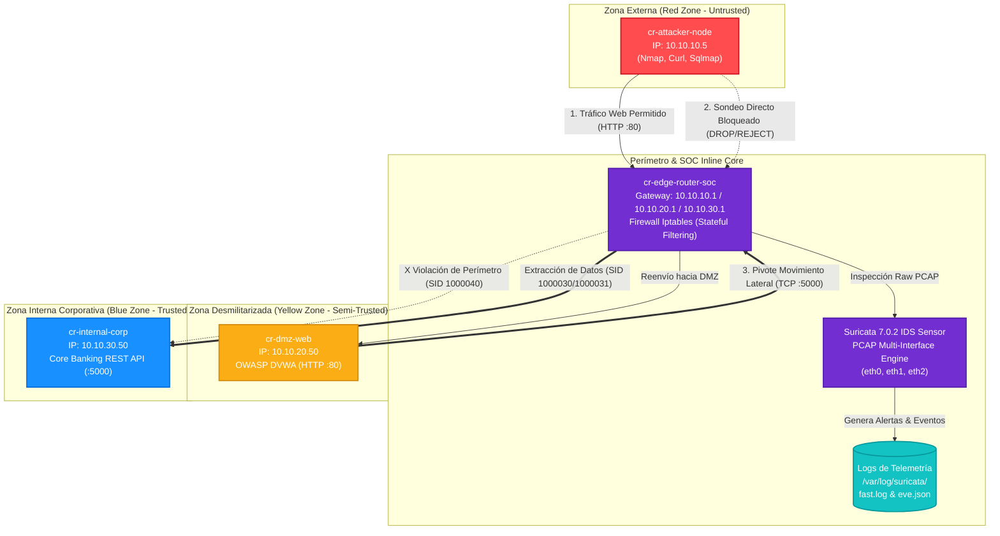
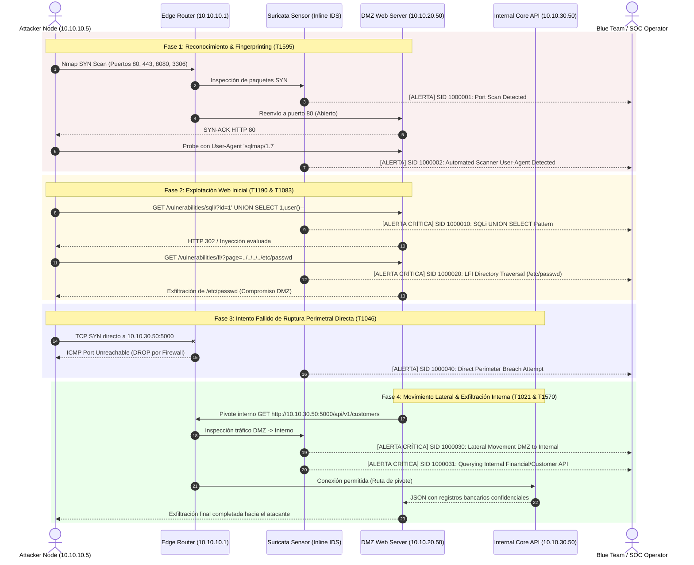
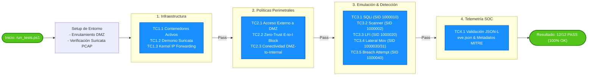

# Cyber Range: Web Attack & Lateral Movement Detection Lab

Laboratorio automatizado multi-segmento diseñado para entrenamiento y pruebas de **Red Team**, **Blue Team** y **Purple Team**.

> [!TIP]
> 📚 **Material Pedagógico:** Consulta la [Guía Práctica para Estudiantes (GUIA_ESTUDIANTE.md)](GUIA_ESTUDIANTE.md) para realizar paso a paso los ejercicios del laboratorio, y el [Informe Técnico (report.md)](report.md) para el análisis forense de telemetría y hardening.

---

## 1. Arquitectura de Red y Topología

El entorno implementa una segmentación estricta de 3 zonas controlada por un Router/Firewall perimetral con sensor IDS Suricata en línea:



### Tabla de Direccionamiento IP y Políticas:

| Segmento / Zona | CIDR / Subred | Gateway | IP Asignada | Rol / Función | Tecnologías |
|---|---|---|---|---|---|
| **External (Red Zone)** | `10.10.10.0/24` | `10.10.10.1` | `10.10.10.5` | Nodo Atacante (Pentest Tools) | Alpine Security, Nmap, Curl, Sqlmap |
| **DMZ (Yellow Zone)** | `10.10.20.0/24` | `10.10.20.1` | `10.10.20.50` | Aplicación Web Vulnerable | OWASP DVWA (HTTP :80) |
| **Internal (Blue Zone)** | `10.10.30.0/24` | `10.10.30.1` | `10.10.30.50` | Base de Datos / API Corporativa | Python REST Core API (:5000) |
| **SOC / Core Router** | Multi-homed | — | `.1` en c/u | Firewall perimetral + Sensor IDS | Iptables + Suricata IDS Inline |

### Políticas de Tráfico Perimetral
- **Attacker (10.10.10.0/24) ➔ DMZ (10.10.20.50:80):** PERMITIDO (Simula servicio web expuesto a Internet).
- **Attacker (10.10.10.0/24) ➔ Internal (10.10.30.0/24):** DENEGADO / RECHAZADO (Defensa perimetral estricta).
- **DMZ (10.10.20.0/24) ➔ Internal (10.10.30.50:5000):** PERMITIDO (Ruta crítica aprovechada para Movimiento Lateral).

---

## 2. Métodos de Despliegue

### Opción A: Despliegue Inmediato con Docker Compose (Micro-Lab)
Requisitos: Docker & Docker Compose.

```bash
# Iniciar todos los contenedores y el sensor Suricata
docker compose up -d --build

# Verificar estado de los contenedores
docker compose ps
```

### Opción B: Despliegue en GNS3 (Topología de Red Virtual)
Requisitos: GNS3 Server corriendo en `http://localhost:3080` con API REST habilitada.

```bash
# Instalar dependencias opcionales
pip install gns3fy requests

# Desplegar topología automáticamente en GNS3
python gns3_topology_deploy.py --host http://localhost:3080 --project CyberRange_Web_LateralMovement
```

---

## 3. Flujo de Emulación de Amenazas (Attack Lifecycle)



### Plan de Ejecución Autónomo:
```bash
# Ejecución en Linux / macOS / WSL:
chmod +x emulation_attack_and_detect.sh
./emulation_attack_and_detect.sh

# Ejecución en Windows (PowerShell):
.\emulation_attack_and_detect.ps1
```

---

## 4. Mapeo MITRE ATT&CK y Reglas de Detección

| Fase | Técnica MITRE | Vector de Ataque | Regla Suricata (SID) | Regla Wazuh |
|---|---|---|---|---|
| **Reconnaissance** | [T1595](https://attack.mitre.org/techniques/T1595/) | Nmap Port Scan & Sqlmap User-Agent | `1000001`, `1000002` | `100100` |
| **Initial Access** | [T1190](https://attack.mitre.org/techniques/T1190/) | SQL Injection (`UNION SELECT`, `OR 1=1`) | `1000010`, `1000011` | `100100` |
| **Discovery** | [T1083](https://attack.mitre.org/techniques/T1083/) | Path Traversal / LFI (`/etc/passwd`) | `1000020`, `1000021` | `100101` |
| **Lateral Movement** | [T1021](https://attack.mitre.org/techniques/T1021/) | DMZ Web Server Pivot a Internal API | `1000030`, `1000031` | `100102` |
| **Defense Evasion** | [T1046](https://attack.mitre.org/techniques/T1046/) | Sonda directa Atacante a Red Interna | `1000040` | `100103` |

---

## 5. Pipeline de Pruebas Automatizadas (Test Suite)



```powershell
# Ejecución en Windows PowerShell
.\run_tests.ps1

# O directamente con Python
python tests\test_cyber_range.py
```
